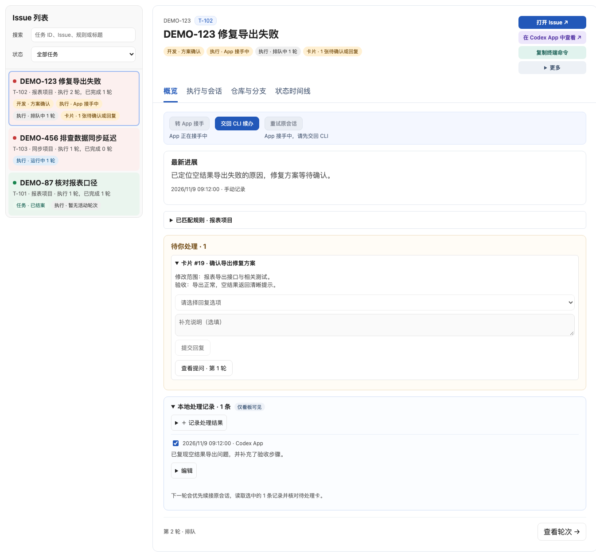
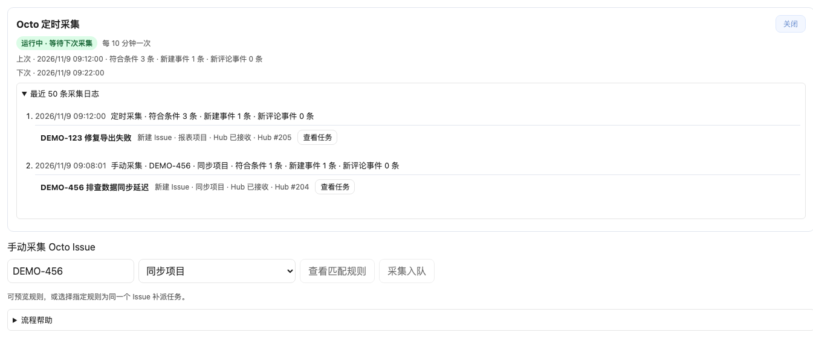
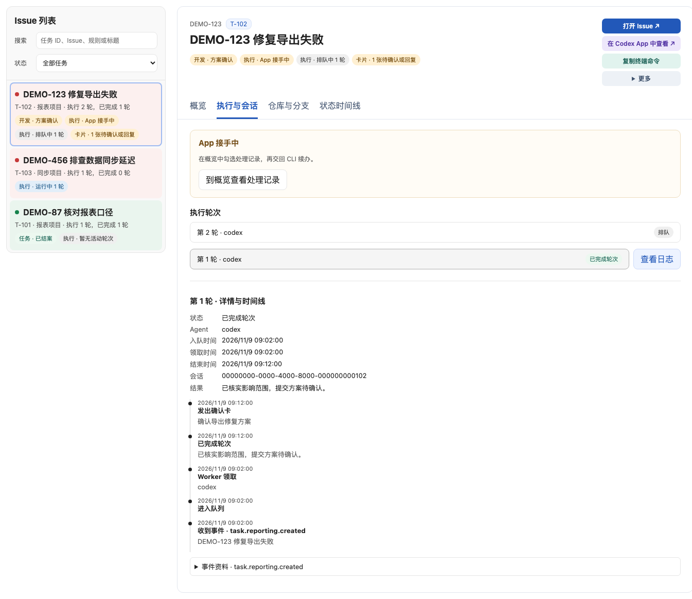
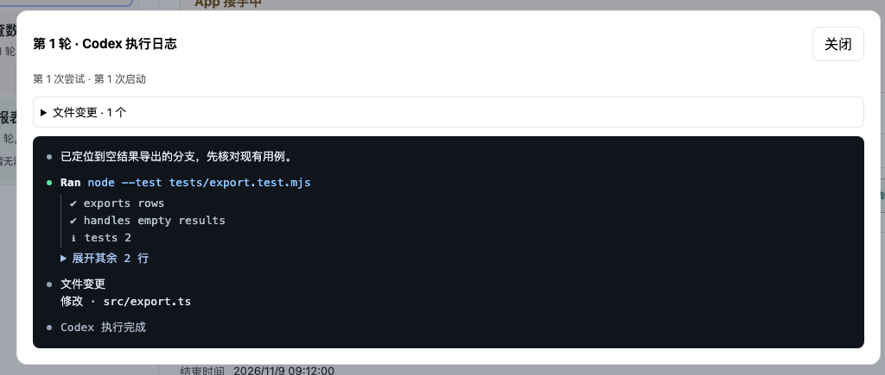
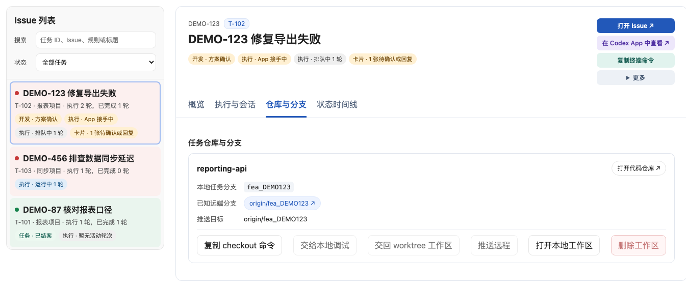
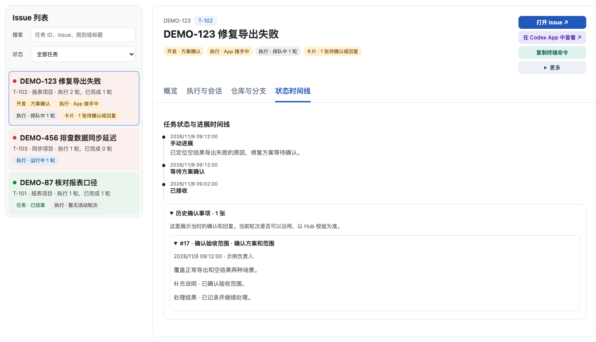
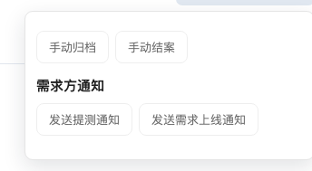

# Agent Autoloop

Agent Autoloop 是一个本机运行的任务中台。它把 Issue、Webhook 和定时事件按规则交给命令行 Agent，保存每轮执行结果，并在需要人决定时发出确认卡。配套的 **loopj 看板** 用浏览器查看任务和日志，也可以回复确认卡、管理 Git 工作区和交接会话。



截图使用虚构 Issue 和本地演示数据。

## 组件

| 组件 | 负责什么 |
| --- | --- |
| Hub | 接收、去重和路由事件，保存任务、轮次、确认卡和会话状态 |
| Worker | 领取轮次，启动 Codex、Claude Code 或自定义 CLI，保存输出并回报结果 |
| loopj 看板 | 按任务 ID 查进度和执行记录，确认方案，管理会话和分支交接 |
| 来源和通道插件 | 接入 Issue、Webhook 和定时采集，按配置投递通知 |

## 快速上手

需要 Node.js 24 或更新版本、Git。实际执行任务时，还需要安装并登录你使用的 Agent CLI。将两个仓库分别保存到同一父目录下，目录名为 `agent-autoloop` 和 `autoloop-dashboard`。看板在连接 Hub 时通过相对路径加载 Hub 的 CLI 和规则校验代码。

仅查看演示看板时，可从 `autoloop-dashboard` 目录运行：

```bash
node server.mjs --demo
```

访问 [本机看板](http://127.0.0.1:3351)。演示模式只使用内置虚构数据。

要在已有本机 Hub 上使用看板，在看板目录运行 `node server.mjs`。首次使用时，在 Hub 仓库执行：

```bash
node bin/agent-autoloop.ts init --agent codex --no-service
node bin/agent-autoloop.ts up
```

Hub 和 Worker 启动后，在另一个终端运行 `node bin/agent-autoloop.ts try` 走一遍确认流程，或运行 `node bin/agent-autoloop.ts status` 查看状态。看板默认读取 `~/.agent-autoloop/config.json`。如使用了独立配置目录，用 `node server.mjs --config <配置文件>` 指定。完整参数和服务管理见[安装说明](INSTALL.md)。

## 规则和任务流程

规则保存在本机的 `rules.json`。每条规则通过 `when` 匹配来源、事件类型或定时表达式，通过 `to` 和 `cwd` 选择 Agent 和工作目录。代码任务还可以通过 `repositories` 配置仓库路径及基线分支。先根据自己的环境修改[仓库规则示例](examples/rules.repositories.json)，再用 `node bin/agent-autoloop.ts check` 检查。

1. **入队。** 来源提交事件，Hub 按规则匹配。启用按事项执行时，规则和 `subject` 一起确定任务归属。同一 Issue 命中多条项目规则时，可在看板用独立任务 ID 区分。
2. **执行。** Worker 领取一轮，在规则指定的目录运行 Agent。Agent 提交进展和结果，Hub 保存轮次。后续评论可以触发续办，并按 `resumeOn` 续接会话。
3. **确认。** 启用 `planApproval` 的代码任务先提交方案，由负责人核对改动和仓库范围。启用 `prepareWorktrees` 时，Worker 在有效审批后准备任务 worktree，再执行开发和验证。
4. **交接。** 用户可以接手 Codex App 会话，或把需求分支交给原项目目录进行本地调试。操作完成后，可交回会话或 worktree 再恢复派发。
5. **收尾。** 项目可按配置记录提测、上线等阶段并发通知。任务结案是单独的操作，会关闭剩余确认卡，后续评论仍留档。

以当前代码实现为准的细节见[协议说明](docs/protocol.md)和[本地工作流设计](docs/local-workflow-design.md)。Octo 为可选接入，配置及采集方式见[Octo 采集器](docs/octo-collector.md)。

## 看板功能

- **任务列表和概览**支持按 Issue、任务 ID、规则和状态筛选，显示待确认卡、进展以及结案状态。
- **执行与会话**可查看每轮时间线和 Codex 日志，展开命令输出，或打开原始 stdout。支持在 Codex App 中接手与交回 CLI。
- **仓库与分支**显示登记的工作区、本地分支和远端链接。支持接管 App 创建的工作区、复制 checkout 命令、在原项目目录和 worktree 之间交接分支，以及确认后推送同名分支。
- **状态时间线**汇总开发阶段、手动进展、交付和结案记录。配置 Octo 后，还可以查看采集明细、预览规则匹配并按指定规则入队。

## 看板截图

### 采集与规则匹配

定时与手动采集记录、事件明细，以及指定规则补派任务。



### 执行与会话

轮次状态、App 接手提示、会话标识和执行时间线。



### Codex 执行日志

命令状态、折叠的长输出和文件变更摘要。



### 仓库与分支

需求分支、远端目标、复制 checkout 命令，以及本地调试和 worktree 交接。



### 状态与确认历史

任务进展、开发阶段和以往确认卡的答复。



### 任务管理与交付通知

手动归档、结案，以及配置 Octo 后的提测与上线通知。



## 本机数据

运行配置、密钥、任务数据库、Worker 日志和真实 Issue 保存在本机数据目录。公开仓库中的示例使用占位路径和虚构数据。看板默认监听本机回环地址，所有者密钥由看板服务端持有。

项目基于 [Agent Autoloop 上游](https://github.com/KKKKhazix/agent-autoloop)。Hub 采用 [MIT 许可](LICENSE)。
